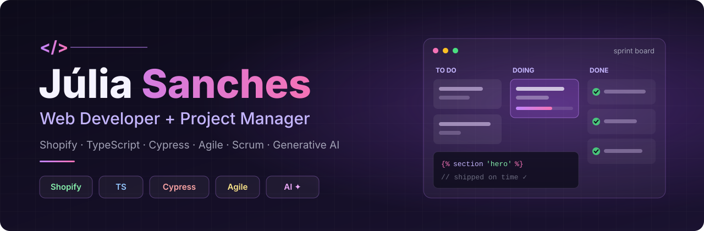

  

  <a href="https://www.linkedin.com/in/j%C3%BAlia-sanches-dourado"><b>LinkedIn ↗</b></a> ·
  <a href="mailto:juliasanchesdourado@gmail.com"><b>Email ↗</b></a>

  Brasília, Brazil · Open to opportunities in IT project management, product and web development

  <a href="#about">About</a> ·
  <a href="#development">Development</a> ·
  <a href="#project-management">Project management</a> ·
  <a href="#ai">AI</a> ·
  <a href="#stack">Stack</a> ·
  <a href="#education">Education</a> ·
  <a href="#contact">Contact</a>

## About

I'm **Júlia Sanches**, a web developer and project manager who enjoys taking projects from idea to launch. For over two and a half years at **iTalents**, I've grown from IT intern to **Junior Web Developer**, working on **Shopify e-commerce** and, more and more, on **technology project management**: organizing demands, running sprints and keeping stakeholders aligned.

I also take on **freelance** projects end to end, from selling the idea and gathering requirements to building the site and supporting it after launch. I'm especially interested in how **generative AI** is changing the way software is built, delivered and found, and I bring it into my day-to-day work.

I'm a **Computer Science** student at UniCEUB, with an academic exchange at **Queensland University of Technology** in Australia, and I'm working toward a career in **IT management**.

## Development

- **Shopify themes** with Liquid, HTML, CSS, JavaScript and TypeScript: building and adjusting sections, metafields and metaobjects
- **Store maintenance**: new features, bug fixes and continuous improvements
- **End-to-end testing** with Cypress, writing reusable test cases that make deliveries more reliable
- **Responsive websites** for clients, including Wix projects
- Code reviews and Git-based workflows
- Python and SQL for data and academic projects

## Project management

- Agile delivery with **Scrum and Kanban**: backlog, sprint tracking, ceremonies and deadlines
- **Requirements gathering**, user stories, acceptance criteria and technical documentation
- **Stakeholder communication** and negotiation, aligning expectations between clients, designers and developers
- Leading my own projects and supporting projects run by teammates

## AI

- Working on **GEO (Generative Engine Optimization)**: how websites show up in AI-generated answers
- Interested in **responsible AI use**, IT governance and data protection (LGPD)
- Following how AI agents and LLM tools are reshaping software teams and product work

## Stack

**Development**

**Management and AI**

## Education

- **B.Sc. in Computer Science** — Centro Universitário de Brasília (UniCEUB) · *2023 – 2027*
- **Study Abroad in Computer Science** — Queensland University of Technology (QUT), Brisbane, Australia · *2026*

**Languages:** Portuguese (native) · English (fluent, C1 — IELTS Academic)

## Contact

The best way to reach me is on [LinkedIn](https://www.linkedin.com/in/j%C3%BAlia-sanches-dourado) or by [email](mailto:juliasanchesdourado@gmail.com).
